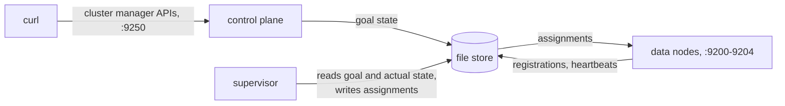

# Demo: three planes, one store

A walkthrough of clusterless OpenSearch on one machine. The three services share nothing but a key/value store, and
the demo brings them up one at a time so each one's contribution is visible:

1. **Data plane.** OpenSearch nodes start, register and heartbeat, and hold no shards: nobody has asked for any.
2. **Control plane.** Cluster manager CRUD works — create an index, read it back — and the index exists in the store.
   Still nothing is assigned: the control plane records what is wanted and never talks to a node.
3. **Supervisor.** It joins the goal state from the control plane to the actual state the nodes report, and assigns
   shards. Each node then has a cluster state holding only what it needs.



Every command runs from the repository root, one terminal per service. The store is a directory, which
`./gradlew clean` deletes, pool definition included.

## Before you start

- **Java 21**, and an OpenSearch main (3.10.0-SNAPSHOT) build in mavenLocal: `cd /path/to/OpenSearch && ./gradlew publishToMavenLocal`.
- Ports 9200–9204 and 9300–9304 (data nodes) and 9250 (control plane) free.
- A fresh store, if an earlier run left one:

  ```bash
  rm -rf data-plane/plugin/build/clusterless-store data-plane/plugin/build/clusterless-ingestion
  ```

## 1. Data plane

```bash
./gradlew :data-plane:plugin:run -Pclusterless.ingestion=true -Pclusterless.segments_only=true -Pclusterless.nodes=5
```

Five nodes on HTTP ports 9200–9204, with the file ingestion source installed and a remote segment store shared by
all of them. Each logs `clusterless: registered node [...] pool [shared-a]` and then publishes every 2s. Each node's
cluster state has no indices and knows of no other node:

```bash
curl 'http://localhost:9200/_cluster/state?pretty'
```

While a node is up, capture what the data plane can do, for the control plane to enforce:

```bash
control-plane/tools/dump-capabilities.sh http://localhost:9200 > /tmp/capabilities.yaml \
    && mv /tmp/capabilities.yaml control-plane/capabilities.yaml
curl -sf 'http://localhost:9200/_cluster/settings_registry' -o control-plane/settings_registry.json
```

`capabilities.yaml` (processor types, script languages and contexts) is committed, so regenerate it only if the
data plane's plugins changed. `_cluster/settings_registry` depends on a proposed upstream OpenSearch change; if the
OpenSearch in mavenLocal does not include it, the request fails (`no handler found for uri`) and writes nothing, and
the control plane runs without `--settings-registry` and accepts any setting.

## 2. Control plane

```bash
./gradlew :control-plane:server:run --args="--store file://$PWD/data-plane/plugin/build/clusterless-store \
    --port 9250 --capabilities $PWD/control-plane/capabilities.yaml \
    --settings-registry $PWD/control-plane/settings_registry.json"
```

Drop `--settings-registry` if step 1 could not produce the file. Paths are absolute because the task runs in
`control-plane/server`. Port 9250 keeps it clear of the nodes; its own default is 9200.

Create a pull-based index, which needs no document writes: each shard reads its own file.

```bash
curl -X PUT 'http://localhost:9250/my-index' -H 'Content-Type: application/json' -d '{
  "settings": {
    "index.number_of_shards": "5",
    "index.number_of_replicas": "0",
    "index.replication.type": "SEGMENT",
    "ingestion_source": {
      "type": "file",
      "param": {"stream": "my-stream", "base_directory": "'"$PWD"'/data-plane/plugin/build/clusterless-ingestion"}
    }
  },
  "mappings": {"properties": {"title": {"type": "text"}}}
}'
curl 'http://localhost:9250/my-index?pretty'
```

The answer is `"acknowledged": true, "shards_acknowledged": false` — true, since no shard exists anywhere. The
index is in the store under tenant `default`, which is the control plane's single-tenant mode, and the nodes'
cluster states are unchanged.

## 3. Supervisor

Once per store, define the pool the nodes declared. Nothing else creates one, and until one exists nothing is
assigned. It serves every tenant without a binding, so `default` needs nothing more:

```bash
STORE=file://$PWD/data-plane/plugin/build/clusterless-store
./gradlew :supervisor:supervisor-app:run --args="--store=$STORE --define-pool=shared-a"
```

Then run it. It is read-only unless told `--write`:

```bash
./gradlew :supervisor:supervisor-app:run --args="--store=$STORE --write --interval=1s"
```

Within a pass or two the shards are placed and started. Compare two nodes:

```bash
curl 'http://localhost:9200/_cluster/state?pretty'
curl 'http://localhost:9201/_cluster/state?pretty'
```

Each lists only itself under `nodes`, and only the shards it holds under `routing_table`, under the index's
internal name `default.my-index.<suffix>` — tenant, name, and a suffix unique to this index. There is no cluster manager, and no node
has the whole picture. The one exception is a search replica: an assertion in OpenSearch's `RoutingNodes` requires
a primary for every shard in a node's routing table, so a node holding a search replica is also told about a primary
for that shard. It never talks to that primary, so the entry need not be the real one.

## 4. Ingestion

Each shard reads `<base_directory>/<stream>/<shard>.ndjson`, and the line number is its offset:

```bash
mkdir -p data-plane/plugin/build/clusterless-ingestion/my-stream
echo '{"_id": "1", "_op_type": "index", "_source": {"title": "hello from shard zero"}}' \
    >> data-plane/plugin/build/clusterless-ingestion/my-stream/0.ndjson
```

Whichever node holds shard 0 picks it up within a second or so, and the others count nothing:

```bash
for port in 9200 9201 9202 9203 9204; do
  echo "$port: $(curl -s "http://localhost:$port/default.my-index.*/_count")"
done
```

A data node knows indices only by their internal names. Resolving the tenant's `my-index` is a coordinator's job;
see coordinator routing in [`data-plane/README.md`](data-plane/README.md).

## Where to read more

- [`control-plane/README.md`](control-plane/README.md): the API surface, tenancy, capabilities and the settings
  registry.
- [`data-plane/README.md`](data-plane/README.md): the plugin, `run` options, remote store and ingestion.
- [`supervisor/README.md`](supervisor/README.md): placement, pools and leases; its `--help` lists every option.
- [`kv-store/README.md`](kv-store/README.md): the store SPI and its file, ZooKeeper and etcd backends.
